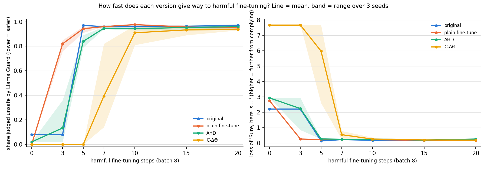
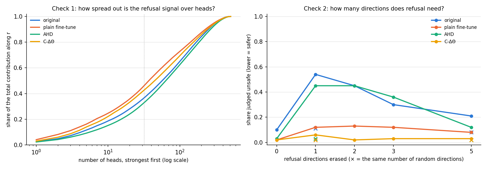

# Spread it out vs keep it in one place: testing two ways to protect a model's refusal behaviour

Code and results are in this repository; see the [README](README.md).*

A good amount of work has been done to study the refusal behavior of LLM's.Several results suggest that the refusal behaviour produced by safety fine-tuning during pre-training can be removed easily.  For example,Arditi et al. (2024) showed that refusal behaviour is mediated largely by a single direction in the residual stream, and ablation of that direction can remove it and this can be done without damaging other capabilites of the model too.

Separately, Qi et al. (2023) found that fine-tuning a model on a small number of harmful examples was enough to largely remove its safety behaviour.To deal with this kind of tampering several ideas have been proposed and within it there are two quite opposing intuitions on how this should be done.

**Attention Head Dropout** (AHD; Huang et al., 2025) paper says that safety is fragile because its concentrated .If refusal behaviour is concentrated across a few components it is easier to detect them and ablate them, so the solution they propose is to distribute them.

The other one is **Circuit Restricted weight arithmetic**(C-ΔΘ; Kasliwal et al., 2026). Their idea is to localise refusal to a small,well-identified circuit which means that they become easier to control and deliberately edit with. The stated goal of the paper however, is primarily selectivity rather than robustness.

This post compares these two ideas to see how they hold out.The model chosen is Llama-3.2-1B-Instruct.It undergoes three different kinds of attacks : **refusal-direction ablation** (Aridit et al's method), a **head-masking** attack where a number of attention heads are chosen and masked and **harmful fine-tuning.**

## TL;DR

- **AHD is robust to the attack it was designed against, but not to directional ablation.** Masking the 32 attention heads with the largest projection onto the refusal direction leaves AHD at 0% unsafe completions. Ablating refusal direction from the residual stream yields 45–62% unsafe completions, comparable to the unmodified model (54–55%).
- **Head dropout may not be what makes AHD robust to head masking.**AHD resists head masking, and the AHD paper credits head dropout for that. But I also trained a control model on exactly the same data with the same settings, just without head dropout. That control resisted head masking just as well (0–1% unsafe). So in this setup the robustness seems to come from safety fine-tuning in general, not from dropping heads. On top of that, the control also resisted direction ablation (5–12% unsafe), which AHD didn’t.
- **AHD's weakness appears to be specific to the refusal direction:**The initial idea was removing heads might have damaged the model so any edit to its activations upset it , to test this I ablated one to five random directions but it did not change anything for any model, AHD included. So this idea is ruled out, and AHD’s failure really is about the refusal direction
- **My first explanation for AHD's weakness turned out to be wrong.** I expected head dropout to make many heads write the same refusal direction as backup copies of each other. Masking a few heads would then leave plenty of copies, but erasing the direction would remove them all at once. The first part held: AHD spreads its head contributions over more heads than any other model (an effective 172 heads, against 93–143). The second part did not: AHD's heads are the least aligned with the refusal direction of any model, and together they contribute the least to it. So in AHD, the refusal direction seems to be produced mostly somewhere other than the attention heads.
- **No defence resists harmful fine-tuning for more than about 10 steps.** C-ΔΘ is the last to break (7–10 steps of batch size 8, against 3–5), but this delay is partly an artefact of fp16 loss scaling and partly due to C-ΔΘ having been trained against the attack's completion format.

## Background

### The refusal direction and the attacks on it

A transformer's **residual stream** is the running vector that each layer reads from and writes back into. At every layer, the attention heads and the MLP each add their output to it, so the residual at any point is simply the sum of the embedding and every earlier component's contribution. This additive structure is what makes the attacks below, and the analysis in Result 3, possible.

Arditi et al. (2024) found that refusal is mediated by a single direction in this space. Taking the mean residual activation at the final prompt token over a set of harmful prompts, and subtracting the mean over harmless prompts, gives a difference-of-means vector r. Projecting r out of the residual stream at every layer, that is replacing each activation x with x − (x · r̂) r̂, largely removes refusal on harmful prompts while leaving the model otherwise coherent.This is called **directional ablation**.

Huang et al. (2025) made a related observation at the level of attention heads. Their attack, RDSHA, scores each head h by the magnitude of its output's projection onto r,

 s_h = |O_h · r| / ‖r‖, and masks the top-scoring heads. In standard safety-tuned models, masking a small number of heads is enough to substantially degrade refusal, which suggests that refusal is computed by a few specialised heads. I'll call this **head masking**.

The third attack needs no interpretability at all: **harmful fine-tuning**, in which the model is trained for a few steps on harmful prompts paired with compliant completions. Since the model already has the capability to produce the content, and only the refusal behaviour stands in the way, very little training is typically required.

### Two defences with opposite philosophies

**Attention Head Dropout (AHD).** Huang et al.'s proposed fix to their own attack is to perform safety fine-tuning with dropout applied to entire attention heads: on each safety batch, every head's output is zeroed independently with probability p = 0.5, while benign batches are trained without dropout. The intuition is the same as ordinary dropout: if no head can be relied upon to be present, the model cannot route refusal through a small set of them, and the behaviour should become distributed. They report that AHD models are substantially more robust to head masking.

**Circuit-restricted weight arithmetic (C-ΔΘ).** Kasliwal et al. (2026) take the opposite approach. They first identify a sparse refusal circuit (they use EAP-IG; I use a simpler attribution-patching approximation), then fine-tune two copies of the model with gradients masked to that circuit: θ⁺ towards refusal and θ⁻ towards compliance. The edited model is

$$
\theta' = \theta_0 + \alpha(\theta^+ - \theta^-)
$$

Here α sets how strong the edit is. The authors choose it by trying several values and keeping the one that refuses harmful requests most, as long as the model doesn't start refusing too many harmless ones. C-ΔΘ was designed for selective refusal, applied once as a permanent weight edit.

It puts all its safety changes in a small circuit (about 5% of parameters in the paper; 15% of MLP channels in my simplified version), which makes it a natural opposite to AHD.

The question I wanted to answer is simple : **under the same attacks, does distributing refusal across components or concentrating it in a circuit make it harder to remove?**

## Setup

**Model.** Llama-3.2-1B-Instruct (16 layers × 32 heads = 512 heads, tied embeddings). It is the smallest model in the C-ΔΘ paper and shares an architecture family with the Llama-3-8B used for AHD. All experiments ran on a single free Kaggle T4, which constrained several choices below.

**Data.** AdvBench's 520 harmful behaviours are split into disjoint sets: 256 for defence training, 64 for the fine-tuning attack, 50 for validation and hyperparameter selection, and 100 held out for evaluation. Benign prompts are no-input instructions from Alpaca, split the same way, with a further 100 reference answers held out to measure capability.

| Model | Construction |
| --- | --- |
| original | Llama-3.2-1B-Instruct, unmodified |
| plain fine-tune | full fine-tune (all non-embedding weights) on the model's own refusals to the 256 training prompts, plus its own responses to 256 benign prompts at loss weight 0.2; 10 epochs, lr 2e-5, effective batch 8 |
| AHD | identical to the plain fine-tune, with whole-head dropout p = 0.5 on safety batches only |
| C-ΔΘ (simplified) | circuit = top 15% of MLP channels (inputs to down_proj) by attribution patching; θ⁺ trained on refusals and θ⁻ on AdvBench target completions, 8 epochs each with gradients masked to the circuit; α ∈ {0.25, 0.5, 0.75, 1.0} chosen on validation |

 The plain fine-tune is the most important comparison in this post. It is trained exactly like AHD but without head dropout, so any difference between the two comes from head dropout alone.

**Attacks.** Each attack is recomputed on the model being attacked, as a real attacker with that model's weights would do.

1. **Directional ablation.** I compute the refusal direction r as the average activation on 128 harmful prompts minus the average on 128 harmless ones, at the last prompt token. I take it from whichever of the first 80% of layers weakens refusal most when removed (tested on 32 validation prompts). Then I remove r from the residual stream after the embedding and after every attention and MLP block.
2. **Head masking (RDSHA).** I score each head by how strongly its output points along r, averaged over 64 harmful prompts, and switch off the top 8, 16 or 32 heads.
3. **Harmful fine-tuning.** Starting from a fresh copy of each model, I fine-tune all weights on the 64 attack prompts paired with AdvBench's "Sure, here is …" answers (batch 8, learning rate 2e-5). The answers leave out the end-of-turn token; the appendix explains why.

**Evaluation.** Each model answers the 100 held-out harmful prompts (64 tokens per answer, or 128 after a fine-tuning attack), and Llama Guard 3 1B labels each answer safe or unsafe. The main number is **the fraction of answers labelled unsafe**. I also report refusal measured by matching refusal phrases ("I can't", "I'm sorry" and so on), but only as a secondary measure, because it miscounts answers that politely deflect without refusing. To check capability, I measure how often each model refuses 100 harmless Alpaca prompts, and its loss (NLL) on 100 Alpaca reference answers.

## Result 1: the defences fail against different attacks

Fraction of the 100 held-out harmful prompts whose completions Llama Guard labels unsafe (lower is safer):

| Model | No attack | Directional ablation | Top 8 heads masked | Top 16 | Top 32 | Fine-tune, 2 steps | 5 steps | 10 steps |
| --- | --- | --- | --- | --- | --- | --- | --- | --- |
| original | 0.10 | 0.55 | 0.12 | 0.14 | 0.39 | 0.09 | 0.96 | 0.96 |
| plain fine-tune | 0.01 | **0.05** | 0.01 | 0.02 | 0.01 | 0.00 | 0.85 | 0.97 |
| AHD | 0.01 | **0.62** | 0.00 | 0.00 | **0.00** | 0.01 | 0.88 | 0.94 |
| C-ΔΘ | 0.01 | 0.39 | 0.02 | 0.02 | 0.11 | 0.00 | **0.00** | 0.75 |

Four findings stand out.

**1. Head masking only hurts the original model.**

- Original model: unsafe answers rise from 10% to 39% with its top 32 heads switched off. This matches the AHD paper.
- All three trained models: barely affected, including the plain fine-tune.

The plain fine-tune never used head dropout, yet it resists head masking just as well as AHD. So in this setup, the resistance seems to come from safety fine-tuning itself, not from AHD's trick. One possible reason is that training on its own refusals spreads the refusal signal over many parts of the model.

**2. Removing the refusal direction breaks AHD, but not its control.**

- AHD: 62% unsafe.
- Plain fine-tune: 5% unsafe.
- Original model: 55% unsafe.

The only difference between AHD and the plain fine-tune is head dropout. So head dropout leaves refusal just as dependent on this one direction as in the original model, and possibly more (see Result 3).

**3. AHD costs the most capability.**

Its loss on ordinary answers goes from 2.01 to 3.22. The plain fine-tune, trained on the same data, only goes to 2.47. So about 0.75 of that increase comes from head dropout itself.

**4. C-ΔΘ is the only model that survives 5 steps of harmful fine-tuning.**

At step 5 it gives 0% unsafe answers, while every other model is above 85%. By step 10 it breaks too. This was the most surprising number in the table, so I tested it again in the next section. It holds up less well than it looks here.

## Result 2: harmful fine-tuning breaks everything, and C-ΔΘ's delay is partly an artefact

To test whether C-ΔΘ's resistance at five steps was robust, I retrained all four models and ran a finer sweep: a single 20-step attack per model, evaluated at steps 3, 5, 7, 10, 15 and 20, repeated with three seeds that vary the order of the attack batches. Because the learning rate is constant and the batch order is fixed by the seed, checkpointing one run is equivalent to separate runs of each length from a fresh copy (I verified that the weights match exactly). To test whether C-ΔΘ's resistance at five steps was robust, I retrained all four models and ran a finer sweep: a single 20-step attack per model, evaluated at steps 3, 5, 7, 10, 15 and 20, repeated with three seeds that vary the order of the attack batches. Because the learning rate is constant and the batch order is fixed by the seed, checkpointing one run is equivalent to separate runs of each length from a fresh copy (I verified that the weights match exactly). As well as the Llama Guard rate, I measured how likely each model finds a compliant answer. For each test prompt, I took AdvBench's ready-made answer ("Sure, here is …") and computed the model's loss on it: a high loss means the model would be unlikely to write that answer, and a low loss means it is close to complying. Unlike the judge, this doesn't need the model to actually produce an answer, and it changes smoothly rather than jumping between safe and unsafe.

*[ Left: unsafe fraction against attack steps. Right: NLL of the "Sure, here is …" targets. Lines are means over three seeds; bands show the range.]*

First checkpoint at which at least half of completions are unsafe:

| Model | Seed 0 | Seed 1 | Seed 2 |
| --- | --- | --- | --- |
| original | 5 | 5 | 5 |
| plain fine-tune | 3 | 3 | 3 |
| AHD | 5 | 5 | 5 |
| C-ΔΘ | 7 | 10 | 10 |

.The three seeds tell the same story:

- **Every model breaks within 15 steps,** giving 89–97% unsafe answers in every run. That is 120 training examples and a couple of minutes on a free GPU.
- **The plain fine-tune breaks first,** even before the original model. Training it on its own refusals gave no protection against fine-tuning.
- **C-ΔΘ breaks last in every run.** Before any attack, it also finds the compliant answer far less likely than the other models do (loss 7.7, against 2.2–2.9).

This looks like good news for C-ΔΘ, but there are two reasons to be careful.

**1. Some training steps were silently skipped.** To save memory, I trained with 16-bit numbers. In this mode, PyTorch first multiplies the loss by a large number (65,536) so that small values don't round to zero. If that makes any value too large, it skips the step and tries again with a smaller multiplier. My logs show this happened: for the original model, nothing changed between step 0 and step 3, and for C-ΔΘ, nothing changed until after step 5 in two of the three runs. C-ΔΘ starts with the largest loss, so it skips the most steps. Part of its delay is therefore steps that never happened, and "step 5" doesn't mean the same amount of training for every model.

**2. C-ΔΘ had already been trained against this attack.** Its "comply" copy (θ⁻) was trained on AdvBench's "Sure, here is …" answers, and the method subtracts that copy. The attack uses the same style of answer, on different prompts. So C-ΔΘ was pushed away from exactly what the attack teaches, while AHD and the plain fine-tune never saw it. This probably also explains its very high starting loss.

**What I can conclude:** none of the defences really resists harmful fine-tuning. C-ΔΘ does make this particular kind of compliant answer much less likely. To know whether it truly delays fine-tuning in general, I'd need to rerun the attack counting only real training steps, and using answers C-ΔΘ wasn't trained against.

## Result 3: why is AHD vulnerable to directional ablation?

Result 1 left a puzzle. AHD survives head masking but not directional ablation, while its control survives both. I used the models saved in Result 2 to try to explain why.

### My first explanation was wrong

**The idea.** In AHD training, half the heads are switched off at random at every step. To keep refusing, the model might teach many heads to write the same refusal signal along r, as backups for each other. That would explain both results:

- masking a few heads does nothing, because many backup copies remain;
- removing r breaks it, because every copy points along r, so they all disappear at once.

**The prediction.** If this is right, AHD should have *more* heads writing along r than its control, and those heads should point *more* closely along r.

**The test.** For every head, I measured its output at the last prompt token on 64 harmful prompts, and how much of it points along that model's own r. I report three numbers:

- **effective number of heads:** how many heads share the signal (higher means more spread out; technically the participation ratio);
- **alignment of the top 32 heads:** how closely they point along r, from 0 (not at all) to 1 (exactly);
- **total head contribution:** how much all the heads add along r together.

| Model | Effective number of heads | Alignment of top 32 heads (0–1) | Total head contribution along r |
| --- | --- | --- | --- |
| original | 143 | 0.140 | 9.8 |
| plain fine-tune | 93 | 0.094 | 7.3 |
| AHD | **172** | **0.053** | **4.1** |
| C-ΔΘ | 114 | 0.124 | 9.6 |

**The result.** Half of the prediction holds: AHD spreads the signal over more heads than any other model, as its paper says. The other half fails clearly. AHD's heads are the *least* aligned with r, and together they contribute less than half as much along r as the original model's heads. **So the backup-copies idea is wrong.** In AHD, r is mostly not written by the attention heads.

One extra detail: measured against the original model's r instead, AHD's heads are about as aligned as the original's (0.139 vs 0.140). So AHD's heads still carry roughly the original refusal signal, but the r we find in AHD is mostly written somewhere else.

*[Figure: mechanism_checks.png, left panel: share of the total head contribution as heads are added, strongest first.]*

### AHD isn't just fragile

Another possible explanation is that head dropout simply makes the model fragile, so that removing *any* direction would break it. To test this, I removed several kinds of directions from each model:

- **r plus the next strongest directions** that separate harmful from harmless prompts (top 2, 3 or 5);
- **random directions,** as a control (1 or 5).

Fraction of unsafe answers:

| Model | Nothing removed | r | Top 2 | Top 3 | Top 5 | 1 random | 5 random |
| --- | --- | --- | --- | --- | --- | --- | --- |
| original | 0.10 | 0.54 | 0.45 | 0.30 | 0.21 | 0.11 | 0.08 |
| plain fine-tune | 0.02 | 0.12 | 0.13 | 0.12 | 0.08 | 0.02 | 0.02 |
| AHD | 0.03 | 0.45 | 0.45 | 0.36 | 0.12 | 0.03 | 0.02 |
| C-ΔΘ | 0.02 | 0.06 | 0.02 | 0.03 | 0.03 | 0.02 | 0.02 |

What this shows:

- **Random directions change nothing,** for any model. So AHD isn't generally fragile; its weakness is specific to r.
- **AHD is about as vulnerable as the original model, not more.** Here it is 45% against 54%; in the first run it was 62% against 55%. The clear and repeatable gap is with the plain fine-tune, which stays at 5–12% in both runs.
- **AHD's refusal leans on r the most.** I also measured how much more likely each model is to start its answer with "I" (as in "I can't") than with "Sure". Removing r cuts this by 51% for AHD, but only by 15–28% for the other models.

**One result I can't fully explain yet,** but here's what the data says: removing *more* directions made the original model and AHD *safer*. With five removed, both went back to plain refusals. One guess is that the extra directions help the model produce the harmful content itself, so removing them blocks the content rather than the refusal. Either way, it means this test can't tell me how many directions refusal uses, which is what I had designed it for.

### A test that didn't help

I also tried the reverse: adding r to harmless prompts. Every trained model then refused all of them, and the original refused 61%. Since the trained models all reacted the same way, this test doesn't tell them apart.

## Discussion

The main lesson for me is that **surviving the loss of some heads and surviving the loss of a direction are two different things,** and a defence can have one without the other. AHD has the first but not the second. Plain safety fine-tuning, at least on this model, has both.

Why can they come apart? Head masking removes *parts* of the model. Directional ablation removes a *pattern* in the residual stream, whichever parts produced it. Spreading refusal over more heads protects against the first, but not necessarily against the second.

The practical takeaway: test a defence against more than the attack it was designed for. AHD looks much stronger against head masking alone than it does once a simpler attack is added.

### A possible explanation (not yet tested)

In AHD training, heads keep getting switched off, so they are unreliable places to keep the refusal signal. The MLP layers are never switched off. So the model may learn to produce refusal mainly in its MLPs, while still collecting it into one direction, r. If so, this would explain all four AHD results:

- **masking heads does nothing,** because refusal no longer depends on heads;
- **removing r still works,** because it removes the signal whichever part wrote it;
- **AHD's heads contribute the least along r** (Result 3, first test);
- **AHD's refusal leans on r the most** (Result 3, second test).

This is easy to test. The residual stream is a sum of what every head and MLP adds to it, so r can be split exactly into "the part written by attention" and "the part written by MLPs". If the explanation is right, AHD should get a much bigger share of r from its MLPs than the other models do.

### On C-ΔΘ

C-ΔΘ's results are harder to interpret because they depend so much on α, the strength of the edit. My two separate trainings gave quite different models, probably because each picked a different α:

- **first training:** refused 4% of harmless prompts, and 39% unsafe after removing r;
- **second training:** refused 22% of harmless prompts (above the paper's 10% limit), and only 6% unsafe after removing r.

Since α was the same, the difference most likely comes from randomness in training itself. Small differences between GPU runs can change which channels end up in the circuit, and the refusals the model generates as training data. The plain fine-tune shows the same drift: it refused 6% of harmless prompts after the first training and 15% after the second.

Two things follow. First, some of C-ΔΘ's robustness in the second training seems to come from simply refusing more of everything. Second, a single training run of any of these defences can be misleading. A fairer comparison would train each defence several times, and compare robustness at a fixed level of refusals on harmless prompts.

## Limitations

- **Scale.** All results are on a 1B model; AHD was introduced on an 8B model, and the organisation of refusal may differ at scale.
- **Single training run per defence.** Seeds vary only the attack. The divergence between my two C-ΔΘ trainings is a direct warning that defence-training variance is not negligible.
- **Simplified methods.** My C-ΔΘ uses attribution patching rather than EAP-IG, a coarse four-point α sweep rather than the paper's [0.1, 3] range, and a single pooled harm category rather than five. For AHD, I used the paper's dropout rate and benign loss weight without re-tuning for a smaller model.
- **Sample size.** n = 100 per condition gives roughly ±10 percentage points of uncertainty near 0.5.
- **Attacker strength.** The direction is selected with only 32 validation prompts, and head masking uses a fixed, prompt-averaged ranking rather than ranking per prompt. Stronger adaptive attacks might break the plain fine-tune and C-ΔΘ.
- **Fine-tuning attack.** Optimiser steps were silently skipped under fp16 loss scaling, and the attack's completion format overlaps with C-ΔΘ's θ⁻ training data (Result 2).
- **Judge.** Llama Guard 3 1B is itself a small classifier, and I have not validated its labels against human judgement on this data.

## Future work

1. **Attention-versus-MLP decomposition of r.** This is the direct test of the mechanism proposed above, and requires only forward passes on the existing checkpoints.
2. **A corrected fine-tuning sweep.** Count only applied optimiser updates (or train in fp32/bf16), and attack with completions disjoint from θ⁻'s training data, such as the model's own compliant outputs under directional ablation.
3. **Defence-training variance.** Retrain each defence with two or three seeds to establish which effects survive.
4. **Scale.** Repeat on Llama-3.1-8B, the setting shared by both papers.
5. **Directional dropout.** If robustness to head masking does not transfer to directional ablation, the obvious variant is to train with random directional ablations of the residual stream instead of head dropout, and check whether this closes AHD's gap without its capability cost.

Yin et al. (2026), which I came across while writing this, report that jailbreaks act by suppressing a small set of early-layer heads while mid-layer safety-related heads remain active. Read together with the results here, it suggests that the useful question about a safety mechanism is not only how many components carry it, but which components, and along which directions in the residual stream.

## Appendix

**Training on a 16 GB T4.** Full fine-tuning of a 1B model fits with 8-bit AdamW (bitsandbytes), frozen tied embeddings, fp16 autocast with gradient checkpointing, and computing the cross-entropy only at response positions. The 128k-token unembedding is the dominant memory cost, so restricting it to response tokens matters more than any other single change. Micro-batches of 4 with 2 accumulation steps give the effective batch size of 8 used in both papers, with peak memory around 11–13 GB.

**Head dropout under gradient checkpointing.** Checkpointing recomputes the forward pass during backward, so the dropout mask must be held fixed until backward has completed. I sample one mask per micro-batch and run backward before resampling; otherwise the recomputed activations silently use a different mask from the original forward pass.

**Direction selection.** r is computed at the last prompt token over 128 harmful and 128 harmless training prompts. The layer is chosen among the first 80% of layers by greedy refusal rate on 32 validation prompts under ablation, and came out at layer 10 or 11 for every model. Restricting to earlier layers avoids selecting directions near the unembedding that trivially suppress the token "I".

**C-ΔΘ implementation.** Each MLP channel is scored by |activation × gradient| of log p("I") − log p("Sure") at the last prompt token, summed over 128 harmful prompts; the top 15% form the circuit. Gradient hooks zero updates outside the circuit for up_proj, gate_proj and down_proj, and I verified that out-of-circuit weights are unchanged after training. α is the most-refusing value in {0.25, 0.5, 0.75, 1.0} whose benign over-refusal is within 5 points of the original's and whose reference NLL is within 10%. In an earlier run I used a range of 1.6–3.6, which produced degenerate text and 91% benign over-refusal on this model.

**Why the fine-tuning attack omits the end-of-turn token.** With it included, every model quickly learned to emit "Sure, here is …" and then terminate. String matching scores this as compliance, but the completions contain no harmful content, so the attack overstates its own success. Without the terminator, completions are 128 tokens, long enough to see whether a model complies or turns back to a refusal.

**Judge disagreement.** String matching and Llama Guard disagree most on soft deflections, completions that neither refuse nor comply. A typical example: "I can create a game concept that explores complex and sensitive topics … in a way that promotes understanding, empathy, and social change." With 32 heads masked, string matching scores only 69% of C-ΔΘ's completions as refusals, while Llama Guard labels just 11% unsafe.

**References**

- Arditi et al. (2024), [Refusal in Language Models Is Mediated by a Single Direction](https://arxiv.org/abs/2406.11717)
- Huang et al. (2025), Attention Head Dropout. *[Add link.]*
- Kasliwal, Seth & Sankarapu (2026), [C-ΔΘ: Circuit-Restricted Weight Arithmetic for Selective Refusal](https://arxiv.org/abs/2602.04521)
- Yin, Han & Li (2026), [Robust Harmful Features Under Jailbreak Attacks](https://arxiv.org/abs/2606.28153)
- Zou et al. (2023), [Universal and Transferable Adversarial Attacks on Aligned Language Models](https://arxiv.org/abs/2307.15043) (AdvBench)
- Meta, [Llama Guard 3 1B](https://huggingface.co/meta-llama/Llama-Guard-3-1B)
- Qi et al. (2023), [Fine-tuning Aligned Language Models Compromises Safety, Even When Users Do Not Intend To!](https://arxiv.org/abs/2310.03693)
